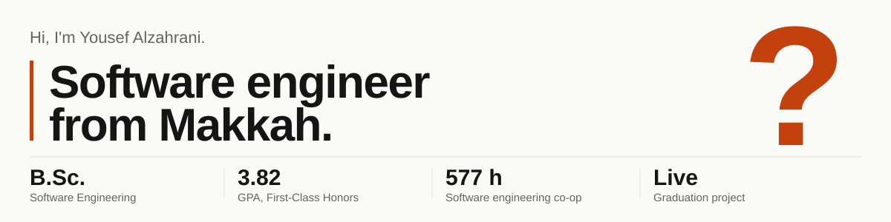

<picture>
  <source media="(prefers-color-scheme: dark)" srcset="assets/header-dark.svg">
  
</picture>

Interviewers usually ask the same questions, so I've answered them here. The longer versions are on my [portfolio](https://mru52.github.io/).

### What have you built?

**[AutoAcad](https://autoacad.com)** is my graduation project and it is live. It turns hours of university accreditation paperwork into minutes: it reads instructors' Word, Excel and PDF files and produces the official course report.
`TypeScript` `React` `Node.js` `Express` `PostgreSQL`

**[TraceCraft](https://github.com/MrU52/tracecraft)** is a reliability library written from scratch in TypeScript: rate limiter, circuit breaker and retries with backoff, plus a workbench for breaking a simulated service. Tested in CI on Node 20 and 22.

**[CourseSpec Toolkit](https://github.com/MrU52/CourseSpec-DOCX-PDF-Toolkit)** is a Node.js service that generates Word documents from JSON templates and converts them to PDF.

### Where have you worked?

Software Engineering Co-op Trainee at First City for Information Technology, Research and Development, Makkah (Aug to Nov 2025, 577 hours). I built a real-time dashboard that streams live camera feeds to the browser, and a background snapshot service, inside a production system.

### What are your grades?

B.Sc. Software Engineering, Umm Al-Qura University, 2022 to 2026. GPA 3.82 / 4.00, First-Class Honors.

### How do you approach a problem?

Understand it first, keep the solution simple, and prove it works with tests. In AutoAcad and TraceCraft, tests run automatically on every change, so problems show up before users see them.

### How can I reach you?

[yousef.moh.alzahrani@gmail.com](mailto:yousef.moh.alzahrani@gmail.com) · [LinkedIn](https://www.linkedin.com/in/yousef-alzahrani52/) · [Portfolio](https://mru52.github.io/)
